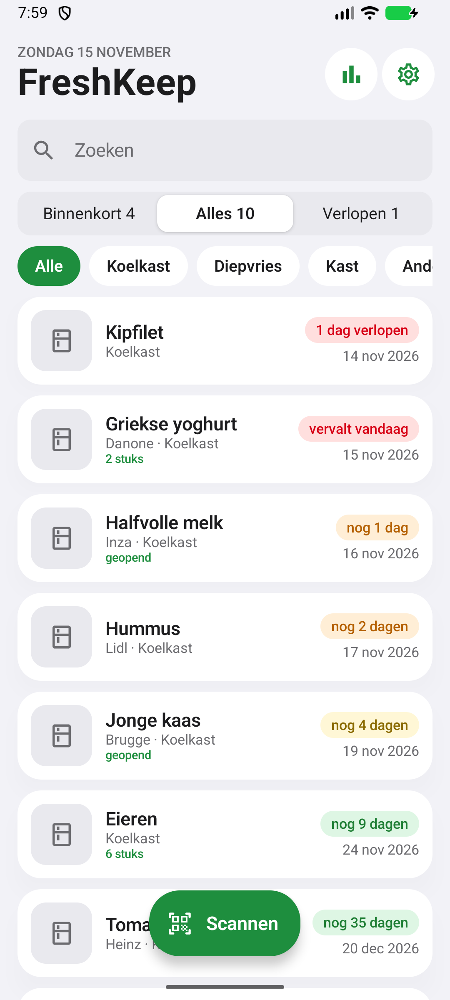
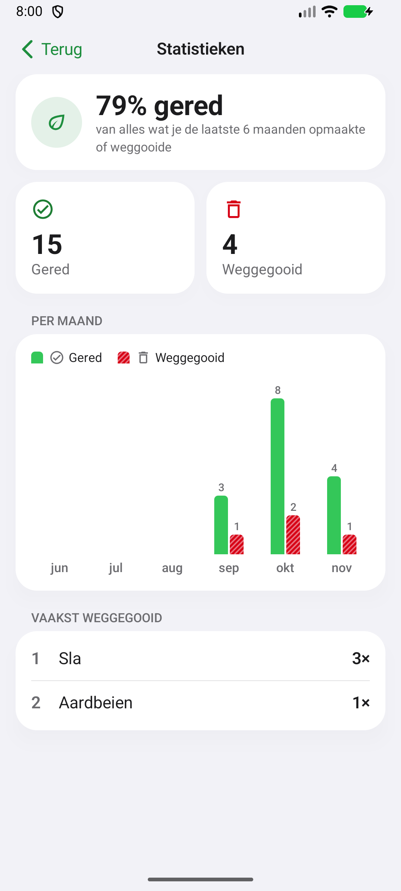
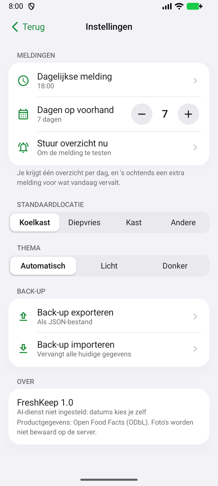

# FreshKeep — never throw away forgotten food again

FreshKeep keeps track of what's in your fridge, freezer and pantry, and reminds you **before** things expire.
Scan a barcode, set the date, done. Every day you get one short overview of what to eat first.

| Your food at a glance | How much you saved | Settings |
|---|---|---|
|  |  |  |

🌍 **Website:** <https://thiagofernandezguillen-rgb.github.io/freshkeep/>
⬇️ **Download:** [FreshKeep.apk](https://github.com/thiagofernandezguillen-rgb/freshkeep/releases/latest/download/FreshKeep.apk)

## Features

- **Scan & add** — scan the barcode with your camera; the product name is looked up automatically via [Open Food Facts](https://world.openfoodfacts.org). No barcode? Add it by hand.
- **Expiry at a glance** — colour-coded labels: *expired*, *expires today*, *1 day left*, …
- **Fridge, freezer, pantry** — filter by location; search everything.
- **Opened products** — mark items as opened and keep track of when.
- **Daily reminder** — one overview per day at a time you choose, plus a morning alert for what expires today.
- **Statistics** — see what you used versus what you threw away, per month, and what you waste most often.
- **Backup** — export and import everything as a JSON file.
- **Light & dark theme.**
- **Optional AI** — read expiry dates and recognise products from a photo (requires your own backend, see below).

> The interface is currently in **Dutch**.

## Install

Requirements: an Android phone with Android 8.0 (API 26) or newer.

1. On your phone, download [FreshKeep.apk](https://github.com/thiagofernandezguillen-rgb/freshkeep/releases/latest/download/FreshKeep.apk).
2. Open the downloaded file. If Android asks, allow your browser or file manager to **install unknown apps**.
3. Tap **Install**, open FreshKeep and allow **notifications** (for the daily reminder) and the **camera** (for scanning).

## Privacy

- Your products, dates and statistics are stored **only on your phone**.
- When you scan a barcode, only that barcode is sent to Open Food Facts to look up the product name.
- The optional AI features send a photo to your own backend, which forwards it to Google Gemini; photos are never stored.
- No ads, no tracking, no analytics.

## Build from source

Open the project in Android Studio and press *Run*, or:

```
./gradlew :app:assembleDebug
```

### Optional: AI backend

The AI features (reading dates from a photo, recognising products, shelf life after opening) need a small Cloudflare Worker with your own Gemini API key.
Step-by-step instructions (in Dutch) are in [`backend/README.md`](backend/README.md).
Without it, the app works normally — you just pick dates yourself.
The published APK does **not** include an AI backend.

## License

[MIT](LICENSE). Product data from [Open Food Facts](https://world.openfoodfacts.org) (ODbL).
